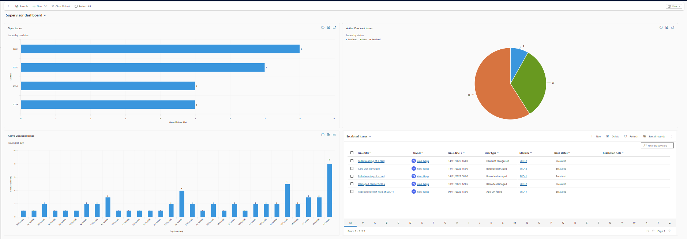
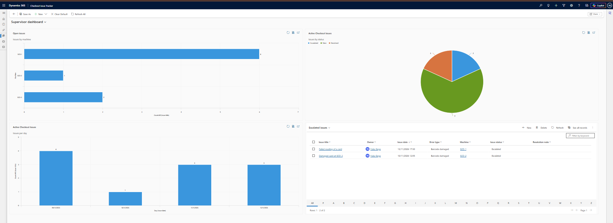
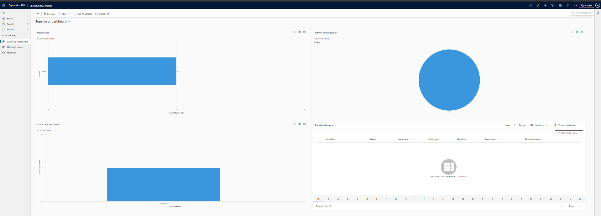
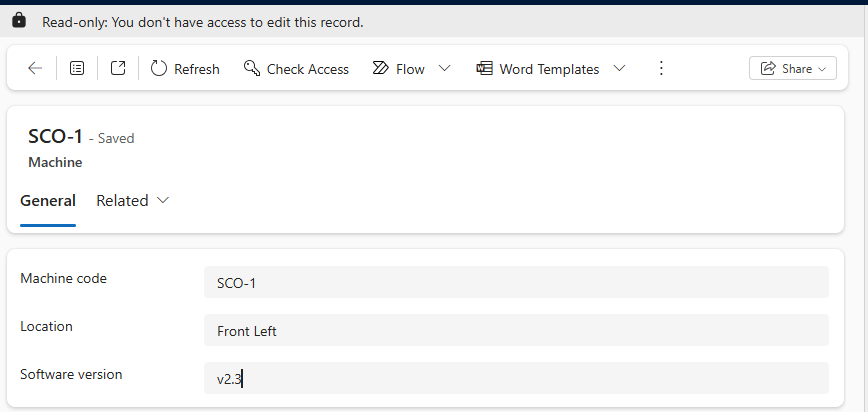
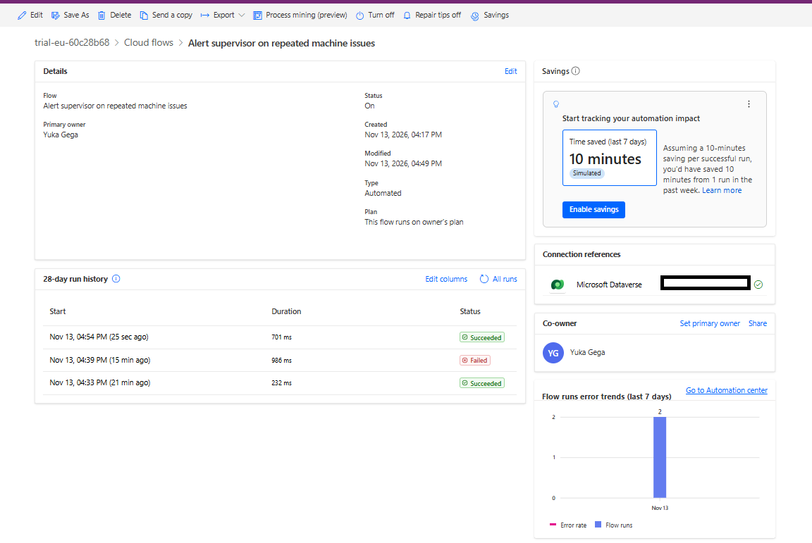
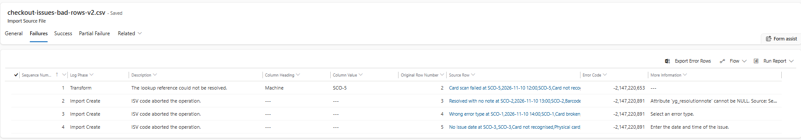
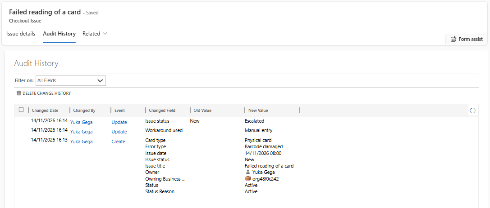

# Checkout Issue Tracker (Microsoft Dynamics 365 / Dataverse)

A model-driven app that logs loyalty card scan failures at self-checkout machines, alerts supervisors when one machine keeps failing, and reports the impact over time.

Built in a Dynamics 365 trial environment over two weeks in November 2026, as a hands-on CRM administration project. Current release: **1.1.0.2**.

## The problem

In a grocery store I've worked in, customers' loyalty cards and app QR codes regularly failed to scan at self-checkout machines. Staff fixed each case by typing the card number in manually and told a supervisor verbally. Nothing was recorded, so there was no count per machine and no evidence to give the vendor when a software update seemed to cause the faults.

All data in this project is fictional, and no company is named.

## User stories

| ID | As a... | I want to... | So that... |
| --- | --- | --- | --- |
| US1 | Staff member | log a failed scan in under 30 seconds | the queue keeps moving |
| US2 | Supervisor | be alerted when one machine has repeated failures | I can escalate early |
| US3 | Manager | see failures by machine and over time | I can show the vendor the impact |

## What I built

| Area | Details |
| --- | --- |
| Data model | Two custom tables: **Checkout Issue** (user-owned) and **Machine** (organisation-owned), linked by a required lookup with Restrict delete. Four choice columns: Error type, Card type, Workaround used, Issue status. |
| App | Model-driven app with a two-section form, three views (Active, Open issues, Escalated issues) and a Machines view. |
| Business rules | Four rules, all with Entity (server-side) scope: resolution note required when resolved, block resolve without a note, error type required, issue date required. |
| Security | Two roles copied from Basic User. **Checkout Staff:** create, read and edit their own issues only, no delete, read-only machines. **Checkout Supervisor:** all issues, assign, manage machines. Deactivate hidden on the command bar. |
| Automation | Power Automate cloud flow: when an issue is added, count the open issues on the same machine; at exactly 5, escalate the new issue. |
| Reporting | Three charts and a Supervisor dashboard (open issues by machine, issues by status, issues per day, escalated list). |
| Data | 42 historical issues imported from CSV; invalid rows tested and rejected. |
| Administration | Auditing, solution checker (0 issues), versioning, managed and unmanaged exports. |

## Key design decisions

1. **Different ownership for each table.** Who logged an issue matters, so Checkout Issue is user-owned and security can limit staff to their own records. Machines are shared reference data, so they're organisation-owned.
2. **A lookup, not free text, for the machine.** My first test data had "SCO-1" and "SCO 1" for the same machine, which made counts per machine wrong. A separate Machine table and a lookup removed the problem.
3. **Restrict delete on the relationship.** A machine with logged issues can't be deleted, so the history stays linked to where it happened.
4. **Server-side rules for data that must be correct.** Testing showed that a column set to "Business required" is only enforced on forms. An import saved an issue with no error type. Entity-scope business rules block bad data from forms, the data grid and imports.
5. **Roles built from Basic User.** A role built from scratch can't even open the app. Linking an issue to a machine needs Append on Checkout Issue and Append To on Machine.
6. **Escalate once, not every time.** The flow checks "equals 5", not "5 or more", so a supervisor is alerted when the threshold is crossed rather than on every later issue.

## Security in action

Same dashboard, different data: row-level security also applies to charts.

  
  

Staff can read machines but not change them:

## Automation

My first design sent an email, but the run failed because the Mail connector is restricted on new tenants. The Gmail connector can't be combined with Dataverse in one flow, and Office 365 Outlook needed a mailbox the trial account didn't have. I changed the design so the flow escalates the issue itself, and supervisors see it in the Escalated issues view.

## Testing (UAT)

14 test cases, each linked to a user story, run as admin and as a staff test user. Final result: **12 Pass, 2 Pass with note, 0 Fail.** Four tests passed only after a fix and retest.

- **DEF-01 (found in UAT):** issues could be saved without a date, which showed as "(blank)" in the trend chart. Fixed with a fourth business rule and retested.
- **DEF-02 (introduced by me, caught before release):** while trying to change an error message, I added an action that would have blocked every resolve. Reverted and retested.

Bad import rows are rejected, each with its own reason:

Full results: [docs/uat-test-cases.md](docs/uat-test-cases.md)

## Administration

- Auditing enabled at environment, table and column level.
- Solution checker: 0 issues.
- Exported as managed (for deployment) and unmanaged (editable) packages. Removed an unused Mail connection reference before export, so the package doesn't depend on a restricted connector.

## Limitations

- Hiding Deactivate is a UI-level control; staff still have Write permission, so full enforcement would need server-side logic.
- The per-day chart skips days with no issues. Power BI would suit vendor trend reports better.
- Staff can open the Supervisor dashboard, although the data is filtered by security. In production, I'd use a separate staff app.
- "Staff cannot change the status" would need column-level security, so I kept the simpler rule "staff only see and edit their own issues".

## What I learned

- Test as the real user, not as the admin. Most gaps only appeared when I signed in as the staff test user or imported data.
- Required on a form doesn't mean required in the data.
- Check regional settings before entering or importing data. A US date format turned 9 November into 11 September in my early test data.
- Turn automation off during bulk imports.

I worked with Microsoft Access for two years at DFEi, so relational design felt familiar. What was new was the enterprise layer: ownership and security roles, solutions, server-side rules and automation.

## Repository contents

| Folder | Contents |
| --- | --- |
| `solution/` | `CheckoutIssueTracker_1_1_0_2.zip` (unmanaged) and `CheckoutIssueTracker_1_1_0_2_managed.zip` |
| `data/` | Sample import file and the invalid-rows test file |
| `docs/` | Daily build log and UAT test cases |
| `screenshots/` | Evidence for each day and test case |

To try it: import the managed solution into a Dataverse environment that has the standard Microsoft app components, then assign the Checkout Staff or Checkout Supervisor role.

- Salesforce version: [salesforce-checkout-case-desk](https://github.com/Yuka-30v/salesforce-checkout-case-desk)
